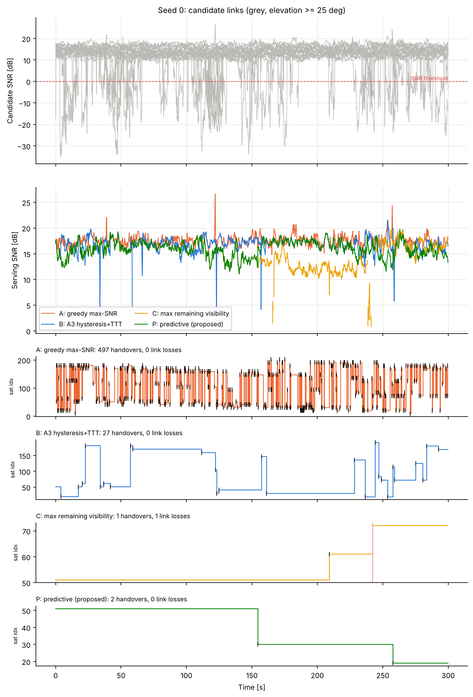
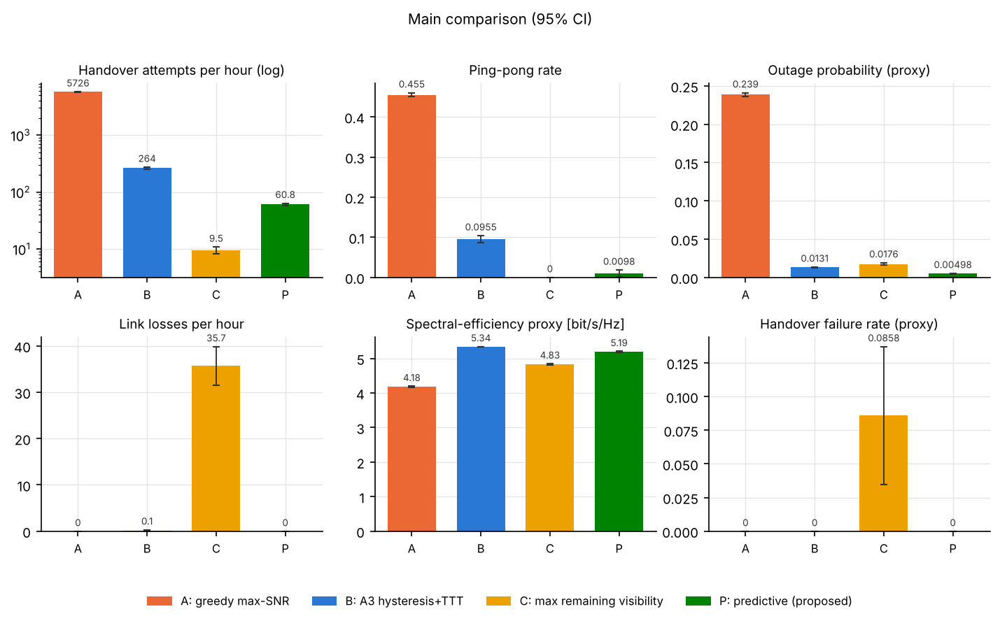
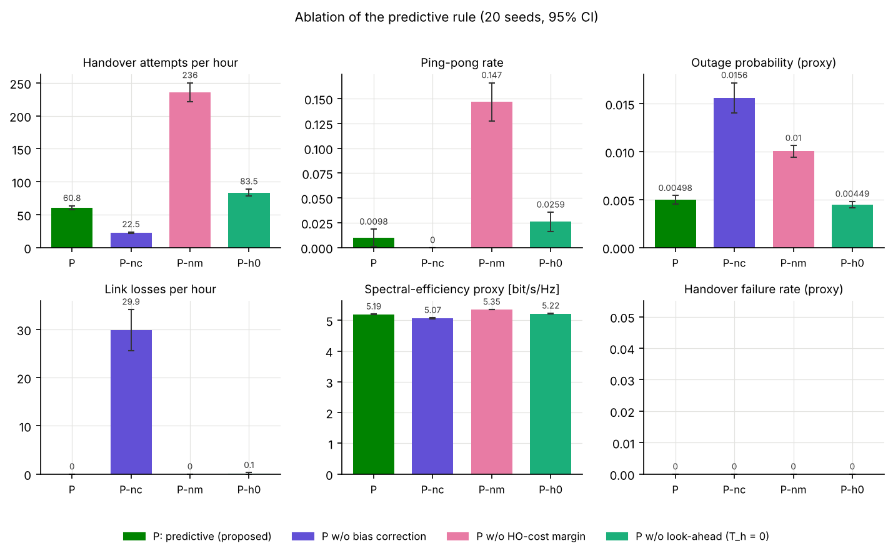
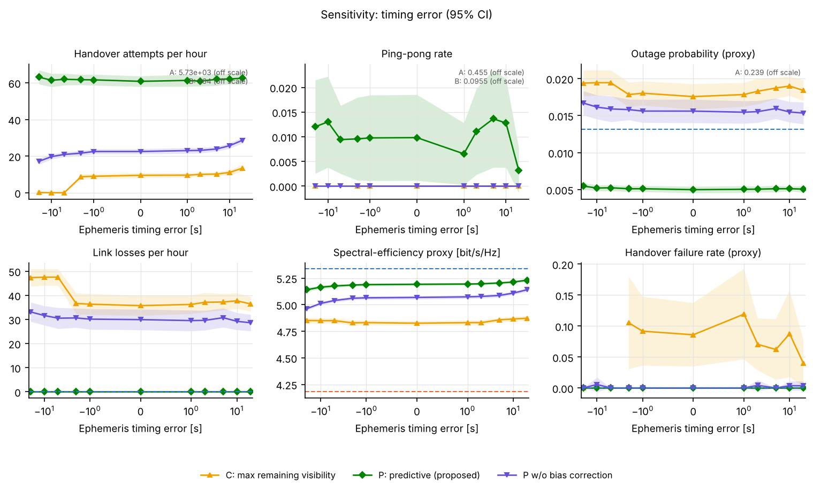

# LEO-NTN Predictive Handover

**A reproducible research framework for ephemeris-aided predictive satellite handover in 5G non-terrestrial networks (NTN)**

[](https://github.com/Weikunkong/leo-ntn-predictive-handover/actions/workflows/tests.yml)
[](LICENSE)
[](pyproject.toml)

> Research question: *Does a lightweight ephemeris-aided predictive handover rule — predicted
> geometry-only link quality over a short horizon, corrected by the measured residual and gated by an
> explicit handover-cost margin — reduce handover count, ping-pong and outage compared with greedy
> max-SNR and 3GPP-style A3 hysteresis/time-to-trigger handover, and how do its gains degrade under
> ephemeris timing error, measurement noise and NLOS blockage?*

<p align="center">
  
</p>

## 1. Project overview

This repository contains a complete, CPU-only Python simulation chain for **satellite-level handover of a
single user in a LEO constellation**:

* **orbit** – Walker-delta constellations or real TLE/OMM element sets propagated with SGP4
  (`python-sgp4`), Earth-fixed frames, elevation / slant range / range rate (`orbit/`);
* **channel** – 3GPP TR 38.821 Set-1 (LEO-600, S-band, handheld UE) link budget and a simplified
  TR 38.811 LOS/NLOS blockage + shadow-fading model (`channel/`);
* **handover** – three baseline rules and the proposed predictive rule with ablations (`handover/`);
* **simulation** – measurement model (noise + TS 38.331 L3 filter), ephemeris oracle with timing error,
  and a discrete-time engine with execution delay, handover-failure, link-loss and recovery abstractions
  (`simulation/`);
* **evaluation** – 15+ KPIs, paired Monte-Carlo statistics with confidence intervals, figures
  (`evaluation/`);
* **experiments** – YAML-configured comparison, ablation and sensitivity sweeps (`experiments/`).

It was built as an individual pre-study ("Phase A") for a Forschungspraktikum in satellite / 5G-NTN
communications. Everything shown here — numbers, figures, tables — is generated by the scripts in this
repository from the configurations in `configs/`.

## 2. Motivation

A LEO satellite at 550 km serves a ground user for only a few minutes; with ~20 satellites above a 25°
elevation mask (Starlink-shell-like density) the candidates are many and of similar quality. 3GPP
Rel-17/18 therefore added ephemeris broadcast (SIB19) and time-/location-based conditional-handover
triggers (CondEvent T1/D1/D2) next to the classical measurement events, but it leaves open *how* a
UE/gNB should combine deterministic orbit knowledge with noisy measurements, and how to avoid
unnecessary handovers. The literature shows that ephemeris/location triggers remove most unnecessary
handovers in clean geometry, that conditional handover trades failures for more handovers, and that
learning-based predictive handover is an active field (see `docs/literature_review.md`). What has not
been studied systematically is how a **lightweight, non-learning** ephemeris-aided rule behaves when
the prediction is **imperfect**: stale ephemeris, measurement noise, blockage that ephemeris cannot
foresee, and the execution delay of the handover itself.

## 3. Research question and hypotheses

See the box above. Hypotheses (all falsifiable by the experiments):

* **H1** with error-free ephemeris the predictive rule needs fewer handovers and shows less ping-pong
  than greedy and A3 at equal or lower outage;
* **H2** its advantage degrades gracefully with ephemeris timing error and the measurement-based bias
  correction limits the degradation;
* **H3** under NLOS blockage pure ephemeris prediction is worse than A3, the corrected rule recovers.

All three are supported by the results in §11 — H1 with one caveat: at default settings the rule
trades ≈ 3 % of the throughput proxy for its stability (§11.3–11.4).

Scope: satellite-level (one cell per satellite) handover, transparent payload, downlink SNR as the
link-quality metric, no interference, no protocol stack — see `docs/assumptions.md`.

## 4. Contributions

1. A small, fully documented and tested simulation chain (orbit → link budget → TR 38.811-based
   large-scale channel → measurements → handover engine → KPIs) that runs on a laptop CPU.
2. Fair, configurable baselines: greedy max-SNR, A3 hysteresis + TTT (with a tuning grid), and the
   classical maximum-remaining-visibility rule (ephemeris-only).
3. A lightweight ephemeris-aided predictive rule (`PredictiveHandover`) with three ablations that
   isolate the contribution of (a) measurement-based bias correction, (b) the handover-cost margin and
   (c) the look-ahead horizon.
4. A Monte-Carlo evaluation protocol with paired confidence intervals, robustness sweeps over
   ephemeris timing error and measurement noise, tuning grids for both the baseline and the proposed
   rule, and an honest discussion of where the proposed rule does *not* win.

## 5. System model (summary; details in `docs/methodology.md`)

| Layer | Model | Key defaults |
|---|---|---|
| Orbit | Walker-delta (SGP4 mean elements, WGS72) or TLE/OMM; TEME→ECEF via GMST | 72 × 22 at 550 km / 53° (1584 sats); demo 24 × 24 (576) |
| UE | static or constant-velocity great-circle motion (WGS84) | 49.57° N (Erlangen), longitude + start time randomised per seed |
| Candidates | elevation ≥ `min_elevation_deg` | 25° (≈ 19.5 candidates for 1584 sats) |
| Link budget | TR 38.821 Set-1 LEO-600 S-band: EIRP density 34 dBW/MHz, handheld UE 0 dBi / NF 7 dB / 290 K (G/T −31.6 dB/K), FSPL, aggregate extra loss | SNR 16.9 dB at nadir, 6.8 dB at 1932 km |
| Large-scale channel | TR 38.811 LOS probability, S-band clutter loss and shadow-fading σ per elevation (dense urban / urban / suburban) as a Markov blockage process + AR(1) shadowing | suburban, mean NLOS duration 4 s, decorrelation 2 s |
| Measurements | true SNR + N(0, σ²), TS 38.331 L3 filter (k = 4) every 0.2 s | σ = 1 dB |
| Ephemeris knowledge | geometry-only predictions with along-track timing error ε (1 s ≈ 7.5 km) | ε = 0 (swept −20 … +20 s) |
| Procedure abstraction | execution interruption; target must be usable at completion (else failure); link loss after `link_loss_timeout_s` below `snr_min_db`; recovery to the strongest usable candidate | 0.15 s, 1 s, 0 dB, 0.5 s |

## 6. Handover algorithms

| Name | Rule | Uses ephemeris |
|---|---|---|
| **A – `greedy`** | hand over whenever another candidate is measured stronger | no |
| **B – `a3`** | neighbour better than serving by `hysteresis_db` for `ttt_s` (TS 38.331 event A3 entering condition), strongest triggered neighbour wins | no |
| **C – `maxvis`** | keep the serving satellite until it is predicted to leave the mask within `guard_time_s`, then take the longest remaining visibility (classical "maximum service time"; a time-triggered CHO in spirit) | only |
| **P – `predictive`** (proposed) | utility of each candidate = horizon average (0 … `horizon_s`) of the **capped, bias-corrected** predicted SNR with an outage penalty; hand over to the best *currently usable* candidate only if the utility gain exceeds `margin_db` (waived when the serving satellite is predicted to set within the horizon). The bias is an EWMA of measurement − prediction and decays over the horizon with `bias_decay_s`. | yes + measurements |
| ablations | `predictive_nocorr` (no bias correction), `predictive_nomargin` (margin 0), `predictive_h0` (no look-ahead) | |

The predictive rule needs ≈ 100 µs per decision in pure Python (20 candidates × 6 horizon samples) and
has no training phase.

## 7. Installation

Requirements: Python ≥ 3.10, CPU only, no paid services, < 1 GB RAM for the main scenario.

```bash
git clone https://github.com/Weikunkong/leo-ntn-predictive-handover.git
cd leo-ntn-predictive-handover
python -m venv .venv && source .venv/bin/activate      # Windows: .venv\Scripts\activate
pip install -e ".[dev]"
python -m pytest                                       # 37 tests, ~10 s
```

Dependencies: numpy, scipy, pandas, matplotlib, pyyaml, sgp4 (all MIT/BSD/PSF licensed); no orbital data
download is needed for the default (synthetic) constellations — see `data/README.md` for real TLE/OMM sets.

## 8. Quick start

```bash
python experiments/run_quickstart.py            # 576 satellites, 3 seeds x 10 min, 7 rules: ~10 s - 1 min
```

writes `results/quickstart/csv/quickstart_{runs,summary,paired}.csv` and two figures
(`quickstart_timeline.png`, `quickstart_comparison.png`) and prints a KPI table. Useful options for every
script: `--seeds N`, `--duration S`, `--workers N`, `--config FILE`, `--out DIR`.

Programmatic use:

```python
from leo_ntn_handover.config import load_config
from leo_ntn_handover.simulation import build_scenario, run_algorithm
from leo_ntn_handover.evaluation import compute_metrics

cfg = load_config("configs/quickstart.yaml")
sc = build_scenario(cfg, seed=0)                  # orbit geometry (cached), channel, measurements
res = run_algorithm(sc, "predictive")             # or "greedy", "a3", "maxvis", "predictive_nocorr", ...
print(compute_metrics(res)["ho_rate_per_h"], compute_metrics(res)["outage_prob"])
```

## 9. Reproducing the experiments

```bash
python experiments/run_comparison.py            # main comparison + ablation (20 seeds x 30 min, 1584 sats)
python experiments/run_sensitivity.py           # sensitivity sweeps + tuning grids (configs/starlink_like.yaml)
python experiments/run_sensitivity.py --sweeps timing_error,measurement_noise
python experiments/run_ablation.py              # ablation only
python experiments/plot_results.py --out results/main   # regenerate all figures from the CSV files
bash experiments/run_all.sh                     # everything (roughly 30-40 CPU-minutes; parallelised over --workers)
```

All physical and algorithm parameters live in `configs/*.yaml`; sweeps are declared there as dotted
config paths. Geometry traces are cached in `data/cache/`. Each run writes a `provenance_<experiment>.json`
(versions, seeds, resolved configuration). Determinism and run times: `docs/reproducibility.md`.

## 10. Evaluation metrics

All KPIs are proxies defined on the simplified model (no RRC / RLF timers), see `docs/assumptions.md`:

| KPI | Definition |
|---|---|
| handover rate | handover attempts per simulated hour |
| ping-pong rate | A→B followed by B→A within 10 s / successful handovers |
| short-stay rate, time of stay | handovers followed by another attempt within 10 s; mean time between handovers |
| outage probability | 1 − mean service fraction (below 0 dB, outside the mask, executing a handover/recovery, or disconnected) — decomposed into interruption / below-threshold / disconnected fractions |
| mean outage duration | mean length of contiguous outage episodes |
| link losses per hour | serving link below threshold for 1 s or leaving the mask (RLF proxy) |
| handover failure rate | attempts whose target was unusable at completion / attempts |
| serving SNR | service-weighted mean and 5th percentile |
| spectral-efficiency proxy | service-weighted `min(log2(1 + SNR), 5.5)` bit/s/Hz |
| decision time | mean wall-clock time of one decision call |

Statistics: mean ± 95 % Student-t CI over seeds; paired same-seed differences versus the proposed rule
with paired t-tests (`*_paired.csv`).

## 11. Results

All numbers below are produced by `experiments/run_comparison.py` and `experiments/run_sensitivity.py`
with `configs/starlink_like.yaml` (1584 satellites, UE at 49.6° N, 20 seeds × 30 min, 0.2-s steps,
suburban TR 38.811 environment, σ_meas = 1 dB, execution delay 0.15 s); CSV files, figures and
`provenance_*.json` are in `results/main/`. Mean ± 95 % CI over seeds; paired differences and p-values in
`results/main/csv/comparison_paired.csv`. Rule parameters are the defaults of the configuration (chosen
*before* the tuning grids were run); §11.3 reports tuned settings for both A3 and the proposed rule.

### 11.1 Main comparison (Fig. 2) and ablation (Fig. 4)

| algorithm | HO / h | ping-pong | stay [s] | outage | link losses / h | HO fail | SE proxy | µs / decision |
|---|---|---|---|---|---|---|---|---|
| A greedy max-SNR | 5726.1 ± 63.2 | 0.455 ± 0.005 | 0.5 ± 0.0 | 23.86% ± 0.26% | 0.0 ± 0.0 | 0.000 ± 0.000 | 4.18 ± 0.01 | 5 ± 1 |
| B A3 (3 dB / 0.4 s) | 263.5 ± 10.5 | 0.095 ± 0.009 | 13.5 ± 0.6 | 1.31% ± 0.06% | 0.1 ± 0.2 | 0.000 ± 0.000 | 5.34 ± 0.01 | 6 ± 1 |
| C max visibility | 9.5 ± 1.4 | 0.000 ± 0.000 | 449.7 ± 123.9 | 1.76% ± 0.17% | 35.7 ± 4.2 | 0.086 ± 0.051 | 4.83 ± 0.02 | 17 ± 1 |
| **P predictive** | 60.8 ± 2.9 | 0.010 ± 0.009 | 58.2 ± 3.3 | 0.50% ± 0.04% | 0.0 ± 0.0 | 0.000 ± 0.000 | 5.19 ± 0.01 | 110 ± 4 |
| P w/o bias corr. | 22.5 ± 1.4 | 0.000 ± 0.000 | 158.9 ± 13.4 | 1.56% ± 0.16% | 29.9 ± 4.3 | 0.000 ± 0.000 | 5.07 ± 0.02 | 73 ± 5 |
| P w/o margin | 235.7 ± 14.6 | 0.147 ± 0.019 | 15.2 ± 1.0 | 1.00% ± 0.06% | 0.0 ± 0.0 | 0.000 ± 0.000 | 5.35 ± 0.01 | 110 ± 5 |
| P w/o look-ahead | 83.5 ± 5.6 | 0.026 ± 0.010 | 43.1 ± 3.3 | 0.45% ± 0.03% | 0.1 ± 0.2 | 0.000 ± 0.000 | 5.22 ± 0.01 | 87 ± 3 |

<p align="center"></p>

* **P vs. B (A3, default 3 dB / 0.4 s):** 4.3 × fewer handovers, ping-pong 0.010 vs 0.096, outage proxy
  0.50 % vs 1.31 % (−62 %), all p < 0.001 (paired). **P does not win on the throughput proxy**: 5.19 vs
  5.34 bit/s/Hz (−2.7 %, p < 0.001) because the capped utility stops chasing the strongest link
  (mean serving SNR 16.0 vs 17.0 dB). This is a genuine trade-off between stability and peak link quality.
* **P vs. C (ephemeris-only):** C hands over 6 × less often but cannot see blockage: 36 link losses per
  hour, 8.6 % of its handovers fail (target blocked at completion), outage 1.76 % and the lowest SE.
* **Greedy** is dominated by its own execution interruptions (5700 handovers/h × 0.15 s ≈ 24 % of the
  time), which illustrates why handover cost must enter the decision.
* **Ablation (Fig. 4):** removing the *bias correction* brings back the link losses of the ephemeris-only
  rule (30/h) — measurement feedback is what makes prediction survive blockage (H3 confirmed); removing
  the *margin* multiplies handovers by 3.9 and ping-pong by 15 (H1: the margin is what removes
  ping-pong); removing the *look-ahead* (T_h = 0) increases handovers by 37 % and ping-pong 2.6 × but
  gives a slightly **lower** outage (0.45 % vs 0.50 %, p = 0.02): look-ahead buys stability, not outage.

<p align="center"></p>

### 11.2 Robustness to imperfect prediction (Fig. 3)

The research question's second half is whether the rule survives *imperfect* prediction. The
ephemeris was therefore shifted in time by ε = −20 … +20 s (≈ ±150 km along-track, far beyond what fresh
SIB19 ephemeris would show), same seeds at every level (`fig3_sensitivity_timing_error.png`):

* **P is essentially unaffected** (outage 0.50–0.55 %, 61–63 HO/h): its utility is dominated by SNR
  levels, which the bias correction re-anchors to the measurements every 0.2 s.
* The ephemeris-only rule C is **asymmetric**: with late predictions (ε ≤ −5 s) it makes no handover at
  all and every satellite change becomes a link loss (47/h); with early predictions it hands over too
  early (handover failures 4–12 %). P *without* correction degrades similarly (link losses 29–33/h).
  **H2 confirmed** — more strongly than expected.
* Measurement noise (σ = 0 … 4 dB, `fig3_sensitivity_measurement_noise.png`) tells the same story from
  the other side: A3 goes from 235 to 1104 HO/h and from 1.2 to 4.8 % outage, while P moves from 61 to
  66 HO/h at 0.52–0.53 % outage — the horizon average and the EWMA bias act as an additional filter.

<p align="center"></p>

### 11.3 Tuning grids (Fig. 5) — a fairer comparison

Hysteresis × TTT for A3 (25 settings) and margin × SNR cap for P (18 settings), 20 seeds each
(`sensitivity_a3_tuning_summary.csv`, `sensitivity_predictive_tuning_summary.csv`,
`fig5_tuning_*.png`):

| setting | HO / h | ping-pong | outage | SE proxy |
|---|---|---|---|---|
| A3 default (3 dB, 0.4 s) | 263.5 | 0.096 | 1.31 % | 5.34 |
| A3 best outage in grid (6 dB, 0 s) | 138.1 | 0.050 | 0.58 % | 5.29 |
| A3 best SE in grid (4 dB, 0 s) | 282.7 | 0.104 | 1.18 % | 5.36 |
| P default (margin 2 dB, cap 15 dB) | 60.8 | 0.010 | 0.50 % | 5.19 |
| P (margin 3 dB, cap 20 dB) | 76.9 | 0.011 | 0.51 % | 5.33 |
| P (margin 2 dB, cap 20 dB) | 103.3 | 0.032 | 0.55 % | 5.38 |

A well-tuned A3 (6 dB hysteresis, no TTT) closes most of the outage gap (0.58 % vs 0.50 %) — the
"−62 %" of §11.1 is largely a consequence of the un-tuned default — but still needs 2.3 × more handovers
and 5 × more ping-pong than the default P. Raising the SNR cap of P to 20 dB removes its throughput
disadvantage: P(3 dB, 20 dB) has **fewer handovers (77 vs 138), less ping-pong (0.011 vs 0.050), lower
outage (0.51 % vs 0.58 %) and a higher SE proxy (5.33 vs 5.29)** than the best A3 setting, i.e. it
dominates tuned A3 on all four KPIs in this scenario. Caps of 10 dB are harmful (link losses up to
28/h) because the capped utilities of all candidates become equal and the margin then blocks necessary
handovers — margin and cap must be tuned jointly.

### 11.4 Where the proposed rule does not win, and other caveats

* Throughput: with the default cap P trades ≈ 3 % of the SE proxy for stability; a higher cap recovers it
  (§11.3) at the price of more handovers.
* Look-ahead reduces handovers but slightly increases outage; blockage robustness comes from the
  measurement feedback, not from prediction.
* Decision cost: P needs ≈ 110 µs per decision in Python versus 5–6 µs for A3/greedy (≈ 20 ×, still
  negligible against a 200-ms decision period; no training).
* All KPIs are proxies of a simplified model without interference or protocol procedures (§12).

## 12. Limitations

* **No interference**: the link metric is a noise-only SNR; inter-beam/inter-satellite interference would
  compress the differences between candidates. **No protocol stack**: execution delay, failure, link
  loss and recovery are single-parameter abstractions, not RRC/RLF procedures; the outage and failure
  KPIs are proxies, not 3GPP availability figures.
* **Ideal beam steering** (maximum satellite antenna gain, one cell per satellite): beam-level handover
  inside a pass is not modelled.
* **Channel**: the TR 38.811 tables give elevation-dependent statistics but no temporal model; the
  Markov sojourn time and the shadowing decorrelation time are free parameters; no fast fading.
* **Ephemeris error** is a single along-track timing offset; radial/cross-track errors, UE position error
  and clock errors are not modelled separately.
* **Single UE, one latitude band** (49.6° N, 53° shell); results for polar/equatorial regions differ.
* The predictive rule's parameters (horizon, margin, cap, bias time constant) were set by hand and
  checked with a small tuning grid; a systematic optimisation is future work (`docs/fp_extension_plan.md`).

## 13. Repository structure

```text
leo-ntn-predictive-handover/
├── README.md, LICENSE (MIT), CITATION.cff, pyproject.toml, requirements.txt
├── configs/                 quickstart.yaml (demo), starlink_like.yaml (main scenario + sweeps)
├── src/leo_ntn_handover/
│   ├── config.py            YAML -> typed dataclasses, dotted-path overrides, geometry hashing
│   ├── constants.py
│   ├── orbit/               walker.py (Walker-delta -> SGP4 records), tle.py (TLE/OMM loaders),
│   │                        propagation.py (SatrecArray), frames.py (GMST, TEME->ECEF, look angles)
│   ├── mobility/ue.py       static / constant-velocity UE trajectory
│   ├── channel/             link_budget.py, tr38811.py (tables), fading.py (Markov blockage + AR(1))
│   ├── simulation/          geometry.py (cached traces), ephemeris.py (oracle + timing error),
│   │                        measurement.py (noise + L3 filter), engine.py, scenario.py
│   ├── handover/            base.py, greedy.py, a3.py, max_visibility.py, predictive.py, registry.py
│   ├── evaluation/          metrics.py, stats.py (CIs, paired tests), plotting.py
│   └── experiments/runner.py  Monte-Carlo runs and sweeps (multiprocessing)
├── experiments/             run_quickstart.py, run_comparison.py, run_sensitivity.py, run_ablation.py,
│                            plot_results.py, make_results_table.py, run_all.sh, _common.py
├── tests/                   37 unit / integration tests (pytest)
├── results/                 committed CSV summaries, figures and provenance of the runs reported here
├── data/README.md           how to use CelesTrak TLE/OMM files (data/cache is generated, git-ignored)
├── docs/                    methodology.md, assumptions.md, literature_review.md, reproducibility.md,
│                            fp_extension_plan.md, project_summary_en.md
└── .github/workflows/tests.yml  CI: pytest + quick-start smoke run (Python 3.10, 3.12)
```

## 14. References

Standards: 3GPP TR 38.811 (NTN channel/scenario study), TR 38.821 (NTN solutions, Set-1 parameters),
TS 38.300 §16.14 and TS 38.331 §5.5.4 (NTN conditional handover, CondEvent T1/D1/D2, SIB19), Rel-18
NR_NTN_enh and Rel-19 NR_NTN_Ph3 work items.
Selected papers: Juan et al. (WCNC 2022, IEEE Access 2022, VTC 2022) on CHO and location-based
triggering in LEO; Zhang et al. (CNSM 2024) signalling-aware CHO; Seeram et al. (2025) CHO delay vs.
architecture; Kodheli, Solaija, Arslan (WCNC 2024) trigger comparison; Demir et al. (2022) and Eydian et
al. (IEEE OJCOMS 2025) hysteresis/margins; Voicu et al. (IEEE Access 2024) multi-criteria rules; Lee et
al. (IEEE Comm. Lett. 2025), He et al. (2026) and Corici et al. (2026) learning/predictive handover;
Raghunandan, Roshdi, Begaj, Heyn, Rohde (WSA 2025) and Roshdi, Roy, Raghunandan, Heyn (6GNet 2024)
on NTN handover and TN/NTN system-level simulation at Fraunhofer IIS.
Software: `python-sgp4` (MIT). The complete list with links, the open-source survey and the gap analysis
are in `docs/literature_review.md`.

## 15. License

MIT — see `LICENSE`. If you use the framework, please cite it (`CITATION.cff`).
